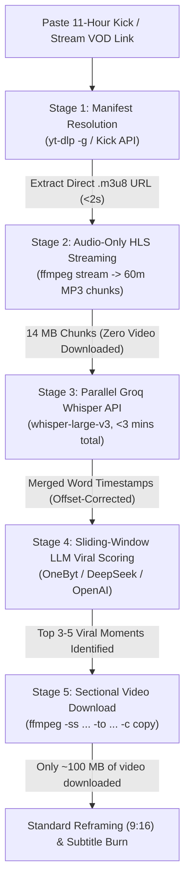

# Long Video & Marathon VOD Ingestion Architecture (Kick / HLS / Streams)

This document outlines the architecture for handling marathon video links (e.g., 5 to 11+ hour Kick VODs, Twitch VODs, and YouTube live archives) without downloading massive video files or crashing the server.

---

## 1. The Bottlenecks with Monolithic Processing

When pasting an 11-hour video link into standard processing pipelines:

1. **Massive Video Download (30 GB – 45 GB)**:
   - Kick streams at 1080p60 (6,000–8,000 kbps). Downloading 11 hours of video takes 1 to 3+ hours, wastes network bandwidth, and risks filling VPS disk space (`No space left on device`).
2. **Groq 25 MB File Limit Rejection**:
   - Audio extracted from an 11-hour video (even at 32 kbps mono) is **~158 MB**.
   - Groq Cloud Whisper has a strict **25 MB per-request limit** (~1.7 hours max).
   - Unhandled, Groq rejects the file with `HTTP 413: Request Entity Too Large`.
3. **Local Whisper CPU Lockup**:
   - Groq failure causes fallback to Local CPU Whisper, pinning server CPU at 100% for 6 to 10+ hours.
4. **LLM Context Window Overflow**:
   - An 11-hour transcript produces **100,000 to 150,000 words**, overflowing LLM context windows or costing massive token budgets.

---

## 2. The 4-Stage Zero-Waste Ingestion Architecture



---

## 3. Step-by-Step Technical Blueprint

### Stage 1: Resolve the Master Stream Manifest
Kick serves all VODs as HLS playlists (`.m3u8`). Instead of downloading the full file, fetch the master manifest URL:
```bash
yt-dlp -g "https://kick.com/video/<video_uuid>"
# Returns: https://stream.kick.com/.../master.m3u8
```

### Stage 2: Stream & Chunk Audio Directly via FFmpeg
Stream only the audio track from Kick's CDN and split into 60-minute MP3 chunks:
```bash
ffmpeg -y -i "<kick_m3u8_url>" \
  -vn -ac 1 -ar 16000 -b:a 32k \
  -f segment -segment_time 3600 \
  chunk_%02d.mp3
```
- **Total Download**: ~150 MB total audio instead of 40 GB video.
- **Chunk Size**: Each 60-minute chunk is only **~14.4 MB** (comfortably under Groq's 25 MB limit).
- **Time**: Takes 2 to 3 minutes to stream.

### Stage 3: High-Speed Transcription via Groq Cloud Whisper
Send each 60-minute chunk to Groq's `/openai/v1/audio/transcriptions`:
- Groq transcribes 60 minutes in **~15 seconds**.
- 11 chunks can be processed in parallel or quick succession (~2.5 minutes total).
- Stitch the resulting word timestamps by adding the time offset:
  $$\text{timestamp}_{\text{global}} = \text{timestamp}_{\text{chunk}} + (\text{chunk\_index} \times 3600)$$

### Stage 4: Sliding-Window Viral Moment Scoring
To evaluate a 120,000-word transcript without exceeding LLM context limits:
1. Divide transcript into **20-minute rolling windows** with a 2-minute overlap.
2. Filter out windows with low word density (silence / pause).
3. Send high-density windows to the LLM (OneByt `deekseek-v4.1-flash-1017` / OpenAI) in parallel.
4. Select the top 3–5 viral moments with global start/end timestamps (e.g. `04:12:15` to `04:13:10`).

### Stage 5: Targeted Sectional Video Download
Download **only** the selected 30–60 second clips directly from Kick's HLS playlist using FFmpeg stream copy:
```bash
ffmpeg -y -ss 04:12:15 -to 04:13:10 \
  -i "<kick_m3u8_url>" \
  -c copy -avoid_negative_ts make_zero \
  clip_1_raw.mp4
```
- **Download Size**: Only **~40 MB to 70 MB** per clip.
- **Speed**: Takes 3–5 seconds to download.
- The raw clip is then passed to [`reframe_v2.py`](file:///c:/Users/Aditya%20Narayan/Desktop/open/openshorts/reframe_v2.py) and subtitle burning.

---

## 4. Performance Comparison

| Metric | Current Monolithic Pipeline | Proposed Chunked HLS Pipeline |
| :--- | :--- | :--- |
| **Video Download Size** | **30 GB – 45 GB** | **~150 MB – 250 MB** |
| **Download Time** | 1 to 2.5 hours | 10 to 20 seconds |
| **Groq 25 MB Limit** | **Fails (HTTP 413)** | **100% Compatible (~14 MB/chunk)** |
| **Transcription Time** | 6 to 10+ hours (CPU Whisper fallback) | **2 to 3 minutes (Groq Cloud)** |
| **Server CPU Load** | 100% CPU lockup for hours | Near 0% (FFmpeg copy + Cloud ASR) |
| **Total Turnaround Time** | **~8 to 12 Hours** | **~4 to 6 Minutes** |
